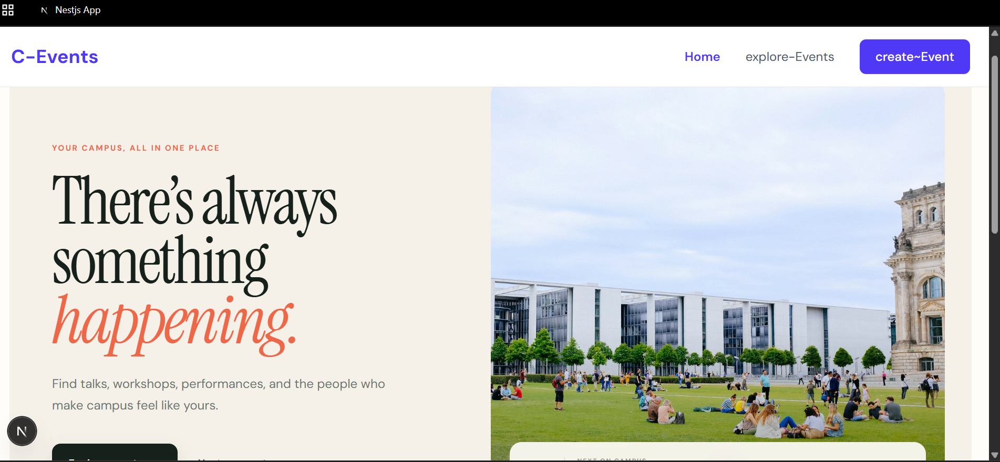

1. Project description,  Campus Event frontend  is a web application built with Next.js that allows students to discover, explore, and participate in campus events.

2. Technologies used: Next.js, React, TypeScript, CSS, REST API, and npm.

3. Installation instructions
 Create repository, navigate into the project directory, and run npm install to install dependencies.

4. To start the development server Run npm run dev or build and start and open http://localhost:3000 in my browser.

5. Backend URL configuration was Create a .env.local file in the my project root and configure NEXT_PUBLIC_API_URL with the project backend API URL which i have built.

6. The Main features is Browse and search events, filter events by category, view event details, create  events, and access role-based functionality.

*** schreenshoot showing main page is below

